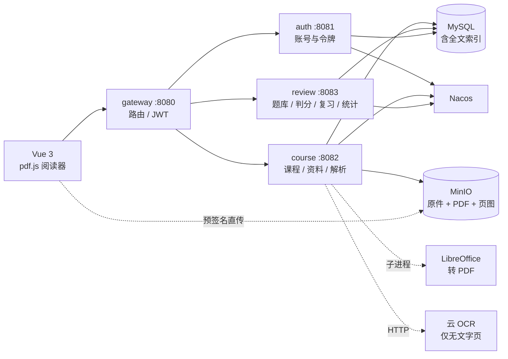

# study-loop

> 课程资料管理与错题复习系统 · 基于 Spring Boot + Spring Cloud 的微服务课程设计

把一份 80 页的课件，变成**一组能定位、能出题、能复习的知识点**。

**当前状态**：需求 v0.3 ｜ 设计阶段 ｜ 代码未开始

---

## 为什么要做

自学一门课，卡住人的从来不是"没资料"：

1. 老师的 PPT 有 80 页，考前想找"红黑树那页"，只能一页页翻。
2. 做错的题抄在纸上，两周后就忘；忘了也不知道自己哪一章最弱。
3. 知道该复习，但不知道**今天该复习哪几道**。

study-loop 做三件事：**存资料 → 解析成可检索的页 → 从页里出题并按记忆曲线复习**。

---

## 功能范围

| 期 | 主题 | 关键能力 |
|---|---|---|
| **V1** | 文档闭环 | 账号、课程与章节、上传、**统一转 PDF**、网页内阅读（翻页/缩放/划选）、原生文本抽取、**扫描页 OCR 兜底**、分题型题库、**客观题自动判分**、今日复习（SM-2）、基础统计 |
| **V2** | 检索与自测 | 全文检索（中文 ngram）、页面缩略图、组卷自测、图表统计、提醒 |
| **V3** | 视频（延后） | B 站 / YouTube / 本地录制，字幕与**云 ASR**，段落时间戳，段落出题 |

**明确不做**：LLM 生成摘要、在线编辑原文件、手写公式识别、教师端、班级分享。

完整清单见 [需求规格](docs/01-需求规格.md)。

---

## 技术栈

| 层 | 选型 |
|---|---|
| 后端 | JDK 17、Spring Boot 3.2、Spring Cloud 2023.0、Spring Cloud Alibaba（Nacos） |
| 网关 | Spring Cloud Gateway（JWT 校验在这一层） |
| 数据 | MySQL 8（FULLTEXT + ngram 做中文检索）、MyBatis-Plus、Redis 7 |
| 文件 | MinIO（预签名直传，文件不经过 Java 内存） |
| 解析 | **LibreOffice**（doc/ppt → PDF）、Apache PDFBox（按页抽文字） |
| OCR | 云 API（百度/腾讯/阿里，`OcrProvider` 接口可切换），仅对无文字页调用 |
| 预览 | pdf.js（前端分页渲染） |
| 文档 | Knife4j（OpenAPI 3） |
| 前端 | Vue 3、Vite、Element Plus、Pinia、ECharts |
| 部署 | Docker Compose、Nginx |

选型理由见 [ADR](docs/adr/README.md)。

---

## 架构



三个业务服务，各自独占一个 schema，只传 id 与快照字段，不跨库 JOIN、不用分布式事务。

解析**不单独拆服务**：它是秒级的本地库调用，拆出去只多一跳网络；但必须走独立线程池，避免大文件把 Web 线程占满（见 [ADR-0003](docs/adr/0003-服务拆分.md)）。

---

## 目录结构

```
study-loop/
├─ README.md                 # 你在这里
├─ CONTRIBUTING.md           # 协作与代码规范
├─ CHANGELOG.md              # 变更日志
├─ docs/
│  ├─ README.md              # 文档索引与写作规则
│  ├─ 01-需求规格.md          # 需求基线 v0.3
│  ├─ adr/                   # 架构决策记录
│  └─ archive/               # 已废弃文档（只读）
├─ study-loop-common/        # 通用返回、异常、上下文
├─ study-loop-gateway/
├─ study-loop-auth/
├─ study-loop-course/        # 含转换（LibreOffice）与解析（PDFBox）
├─ study-loop-review/
├─ study-loop-web/           # 前端（含 pdf.js）
└─ deploy/                   # docker-compose、初始化 SQL、nginx
```

> 目录是**目标态**，代码按里程碑逐个创建，不做空壳占位。

---

## 本地启动

代码尚未开始，本节将在 **M0** 补全，现在不要照抄。

计划中的组件与端口：

| 组件 | 端口 | 说明 |
|---|---|---|
| MySQL | 3306 | `study_auth` / `study_course` / `study_review` |
| Redis | 6379 | 令牌白名单、今日复习缓存 |
| Nacos | 8848 | 单机模式 |
| MinIO | 9000 / 9001 | 9001 为控制台 |
| gateway | 8080 | 前端唯一入口 |
| auth / course / review | 8081 / 8082 / 8083 | |
| web (nginx) | 80 | 生产形态；开发用 Vite 5173 |

---

## 文档

| 文档 | 内容 | 维护时机 |
|---|---|---|
| [需求规格](docs/01-需求规格.md) | 角色、功能清单、判分规则、业务规则、验收脚本 | 需求变更时 |
| [架构决策记录](docs/adr/README.md) | 每个"为什么这么设计"的决策 | 做出决策时 |
| [贡献指南](CONTRIBUTING.md) | 分支、提交、评审、代码规范 | 协作方式变化时 |
| [变更日志](CHANGELOG.md) | 每版做了什么 | 每次发版 |
| [归档](docs/archive/) | 已废弃文档，只读 | 文档被取代时 |

文档规则只有一条：**过期就改，废弃就归档。**

---

## 里程碑

| 里程碑 | 交付 | 验收标准 |
|---|---|---|
| M0 | 工程骨架 + 建表脚本 | 一个服务能起来，Knife4j 能打开 |
| M1 | 网关 + auth + course | 登录拿 token，能建课、上传资料 |
| M2 | 转换 + 解析 + OCR | 传 PPTX → 转 PDF → 出页文本；传扫描件 → 逐页 OCR → 可搜 |
| M3 | 前端主流程 | 预览翻页 / 划选出题 / 今日复习 全流程可点 |
| M4 | 检索 + 组卷 + 统计 | 搜关键词跳页；组卷 10 题自动出分；薄弱章节 |
| M5 | 部署 + 文档 | `docker compose up` 起全栈，报告与 PPT 定稿 |

---

## 协作

- 分支、提交信息、PR 检查清单：见 [CONTRIBUTING.md](CONTRIBUTING.md)
- 所有架构层面的"为什么"写进 [ADR](docs/adr/README.md)，不要只留在聊天记录里
- 提交前自检：能编译、无 `target/`、无密钥、文档已同步

## License

[MIT](LICENSE)
