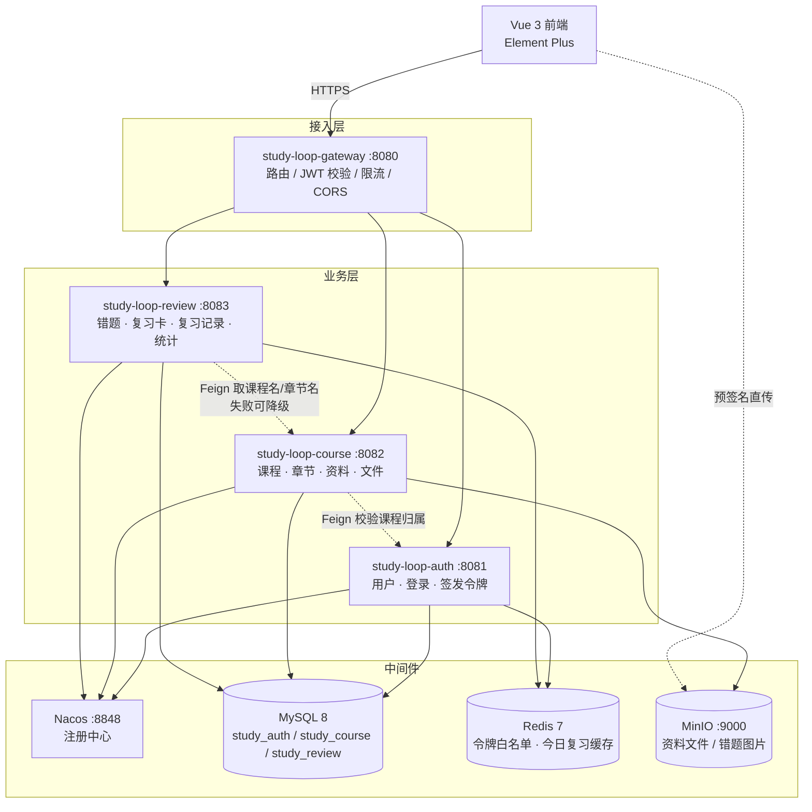

# study-loop 架构设计（v0 · 已废弃）

> ⚠️ **SUPERSEDED · 2026-11-07**
> 本文基于"教师 + 学生双角色"的错误假设撰写。需求已明确为**单角色个人学习工具**（见 [ADR-0002](../adr/0002-定位为单角色个人学习工具.md)），
> 文中教师端、选课、班级统计等内容不再成立。保留此文件仅用于记录决策演进，**请勿作为实现依据**。
> 现行方案：见 [ADR-0003](../adr/0003-服务拆分.md) 与后续 `docs/03-架构设计.md`。

---

> 课程资料管理与错题复习系统 · 基于 Spring Boot + Spring Cloud 微服务
> 本文档回答三个问题：**切成几个服务、为什么这么切、每个服务里放什么**。

---

## 1. 定位与边界

**一句话**：教师把课程资料按「课程 → 章节」组织上传，学生在资料页标记不懂的地方生成错题，系统按记忆曲线安排复习，并把薄弱知识点反馈给学生和教师。

**核心闭环**：`资料 → 练习/标记错题 → 复习计划 → 复习反馈 → 薄弱点统计 → 回到资料`

**明确不做**（写进报告，答辩时主动说，比被问出来强）：

| 不做 | 原因 |
|---|---|
| 分布式事务（Seata） | 业务上不存在"必须同时成功"的跨库写，用快照冗余 + 最终一致更简单 |
| 服务网格 / K8s | 单机 Docker Compose 足够，引入后调试成本远大于收益 |
| 消息队列（RabbitMQ） | v1 无异步刚需；v2 做"复习提醒"再加，不影响现有架构 |
| 在线判题 / 自动批改 | 超出课程设计范围，错题靠学生自评 |
| 多租户 / 多学校 | 单校场景，用户表不隔离租户 |
| 全文检索（ES） | MySQL `LIKE` + 标题索引够用，数据量千级 |

---

## 2. 总体架构



**四个可部署单元**：1 个网关 + 3 个业务服务。

### 为什么是 3 个业务服务，不是 6 个，也不是 1 个

切分依据只有两条，按优先级：

1. **数据所有权**：一张表只能有一个服务写。课程表归 course，错题表归 review，用户表归 auth。
2. **变更频率**：改复习算法不会碰到资料上传，改文件存储不会碰到复习计划。

反面例子（不要这么切）：`user-service` / `file-service` / `comment-service` 这种按技术层切，会导致每加一个功能都要改三个服务，微服务变成分布式单体。

> 答辩口径：**"我按业务能力（bounded context）切了三个服务，每个服务独占一个 schema，服务之间只有 id 引用和快照字段，没有跨库 JOIN。"**

---

## 3. 服务职责

### 3.1 study-loop-gateway（:8080）

- 统一入口，前端只认 `http://host:8080`
- 路由：`/api/auth/**` → auth，`/api/course/**` → course，`/api/review/**` → review
- **JWT 校验放在网关**，校验通过后把 `X-User-Id`、`X-User-Role` 写进请求头传给下游；下游不再解析 token
- 白名单：登录、注册、Swagger 文档
- 统一 CORS，统一 401/403 响应体

> 为什么鉴权放网关：下游服务不需要各自引 JWT 依赖，也不会出现"某个服务忘了校验"的漏洞。代价是网关成为单点，课设可接受。

### 3.2 study-loop-auth（:8081）

| 能力 | 说明 |
|---|---|
| 注册 / 登录 | BCrypt 存密码，登录返回 access + refresh |
| 令牌 | access 2h（JWT），refresh 7d（存 Redis 白名单，可吊销） |
| 当前用户 | `/api/auth/me` |
| 用户管理 | 管理员改角色、禁用 |
| 内部接口 | `/internal/users/{id}` 供其他服务 Feign 调用 |

**不存会话**，无状态；登出 = 从 Redis 删除 refresh 白名单。

### 3.3 study-loop-course（:8082）

| 能力 | 说明 |
|---|---|
| 课程 | 建课、改课、归档（软删除）；教师只能操作自己的课 |
| 章节 | 课程下两级目录（章 → 节），拖拽排序用 `sort` 字段 |
| 选课 | 学生选课 / 退课，`enrollment` 表 |
| 资料 | 元数据落库；文件走 MinIO |
| 文件 | ① 预签名上传 ② 预签名下载（有效期 15 分钟） ③ 预览地址 |
| 内部接口 | `/internal/courses/{id}/brief` 返回课程名+章节名，供 review 拼快照 |

**文件不经过 Java 内存**：前端拿预签名 URL 直接 PUT 到 MinIO，业务服务只存 `object_key`。这是必答点——避免了"大文件上传把服务打挂"。

### 3.4 study-loop-review（:8083）

| 能力 | 说明 |
|---|---|
| 错题 | 录入（文字 + 图片 + 答案 + 解析），按课程/章节/标签筛选 |
| 复习卡 | 每道错题自动生成一张卡，SM-2 算法驱动 |
| 今日复习 | 拉取 `due_date <= 今天` 的卡片，按逾期天数排序 |
| 评分 | 忘记 / 模糊 / 记住 → 更新卡片 + 写日志 |
| 统计 | 连续复习天数、正确率、各知识点错误次数、掌握率 |
| 历史 | 复习日志时间线，支持"这道题我复习了几次" |

**课程名/章节名存快照**（`course_name_snapshot`），不实时 Feign。理由：复习页刷新频率高，Feign 每次都调会放大故障面；课程改名属于低频事件，允许短暂不一致。

---

## 4. 技术选型与版本

| 层 | 选型 | 版本 | 备注 |
|---|---|---|---|
| JDK | OpenJDK | **17** | Boot 3 最低要求 |
| 框架 | Spring Boot | **3.2.12** | 3.2 线最后一个补丁版 |
| 微服务 | Spring Cloud | **2023.0.3** | 与 Boot 3.2.x 对齐 |
| 阿里组件 | Spring Cloud Alibaba | **2023.0.3.3** | 与 Cloud 2023.0.3 对齐（Maven 中央仓已确认存在） |
| 注册中心 | Nacos Server | **2.3.2** | 单机模式 |
| 网关 | Spring Cloud Gateway | 随 Cloud | 响应式，不要引 spring-boot-starter-web |
| 远程调用 | OpenFeign + LoadBalancer | 随 Cloud | 必须配超时 + 降级 |
| ORM | MyBatis-Plus | **3.5.7** | 用 `mybatis-plus-spring-boot3-starter` |
| 数据库 | MySQL | **8.0** | 三个 schema，一个实例 |
| 缓存 | Redis | **7.x** | 令牌白名单、今日队列缓存 |
| 对象存储 | MinIO | 最新 RELEASE | Docker 起，S3 协议 |
| 接口文档 | Knife4j | **4.5.0** | `knife4j-openapi3-jakarta-spring-boot-starter` |
| 工具 | Hutool / Lombok / MapStruct | — | MapStruct 可不引，手写转换更直观 |
| 前端 | Vue 3 + Vite + Element Plus + Pinia + Axios | — | |
| 部署 | Docker Compose + Nginx | — | 一条命令起全栈 |

**版本纪律**：四个 Spring 系依赖的版本必须成组升降。Boot / Cloud / SCA 三者版本错配是这类项目 80% 的"启动就报错"来源。

**不引的东西及理由**（答辩必问）：

| 不引 | 理由 |
|---|---|
| Sentinel | 课设流量可控，Feign 超时 + try/catch 降级足够；引入后要讲清熔断半开状态，性价比低 |
| Seata | 没有跨库强一致场景（见 §6） |
| Elasticsearch | 数据量千级，`LIKE` + 联合索引够 |
| Spring Security 全家桶 | 只有 JWT 校验 + 角色判断，拦截器 30 行能写完，比配 Security 过滤器链更好讲 |
| Nacos 配置中心 | v1 用本地 `application.yml` + 环境变量；配置中心是 v2 加分项，v1 引入会让"改一个配置全站起不来" |

---

## 5. 数据架构

### 5.1 三个库，互不跨库

```
study_auth    ← auth 服务独占写
study_course  ← course 服务独占写
study_review  ← review 服务独占写
```

**铁律**：不允许 `study_review` 里写 `JOIN study_course.course`，不允许一个服务连两个库。

### 5.2 表清单

**study_auth**

| 表 | 关键字段 |
|---|---|
| `sys_user` | id, username(uk), password_hash, nickname, email, avatar, role(STUDENT/TEACHER/ADMIN), status, created_at |
| `sys_refresh_token` | 不放 MySQL，放 Redis：`refresh:{userId}:{jti}` → 过期时间 |

> 角色用单字段枚举，不建 RBAC 五表。报告里写一句"课程设计角色固定为三种，引入完整 RBAC 会增加 4 张表却无实际收益"即可。

**study_course**

| 表 | 关键字段 |
|---|---|
| `course` | id, name, code(uk), teacher_id, cover_key, description, term, status(0草稿/1进行/2归档), deleted, created_at |
| `chapter` | id, course_id, parent_id(0 表示章), title, sort, deleted |
| `material` | id, course_id, chapter_id, title, type(PDF/VIDEO/DOC/IMG/LINK), object_key, mime, size_bytes, uploader_id, download_count, created_at |
| `enrollment` | id, course_id, student_id, created_at, uk(course_id, student_id) |
| `material_tag` | id, material_id, tag_name（v1 可省） |

**study_review**

| 表 | 关键字段 |
|---|---|
| `mistake` | id, user_id, course_id, **course_name_snapshot**, chapter_id, **chapter_title_snapshot**, question_text, question_images(json), answer_text, my_answer, analysis, difficulty(1-5), status(0待复习/1已掌握), deleted, created_at |
| `mistake_tag` | id, mistake_id, tag_name |
| `review_card` | id, mistake_id(uk), user_id, state(NEW/LEARNING/REVIEW/RELEARNING), ease_factor, interval_days, repetitions, lapses, due_date, last_review_at, **version** |
| `review_log` | id, card_id, user_id, rating(0/1/2), prev_interval, next_interval, prev_ease, next_ease, cost_ms, reviewed_at |
| `review_daily_stat` | id, user_id, stat_date, reviewed_count, correct_count, uk(user_id, stat_date)（v1.5 加，做报表提速） |

**索引要点**（写进报告，显得懂）：
- `review_card(user_id, due_date)` 联合索引 —— 今日复习是最高频查询
- `mistake(user_id, course_id, status)` —— 错题列表筛选
- `material(course_id, chapter_id, type)` —— 资料列表
- `review_log(user_id, reviewed_at)` —— 统计时间范围

### 5.3 跨服务引用规则（核心）

1. **只引用 id，不建外键**（跨库外键物理上也不可能）。
2. **需要展示的对方字段，存快照**：`course_name_snapshot`、`chapter_title_snapshot`。
3. **快照何时刷新**：课程改名 / 章节改名 → course 服务发领域事件（v1 用 Feign 主动推送或干脆不刷）；v2 上 RabbitMQ。
4. **对方数据不存在时降级**：review 列表里课程已删 → 前端显示"课程已归档"，不报 500。
5. **删除一律软删除**（`deleted` 标志），跨服务删除只改自己库的状态。

---

## 6. 一致性策略：为什么不要分布式事务

三个服务之间的写操作用例：

| 场景 | 涉及的库 | 是否需要同时成功 |
|---|---|---|
| 建课 | course | 单库，本地事务 |
| 学生选课 | course | 单库 |
| 录入错题（带课程名快照） | review（course 只读） | 否：course 查不到就存 id + null，页面显示"未知课程" |
| 归档课程 | course 写 + review 可能想级联 | 否：review 不动，靠快照继续显示 |
| 删除用户 | auth 写 + course/review 里的数据 | 否：用户软删除，历史数据保留 |

**结论：没有一处需要 XA/Seata。** 用「本地事务 + 快照冗余 + 最终一致 + 允许降级」覆盖全部场景。

这一条要能讲成一段话：*"微服务的分布式事务成本很高，我的业务里跨服务写都是弱依赖，所以我用快照冗余把跨库读变成单库读，用软删除把级联删除变成状态标记，最终一致性靠定时补偿（v2）而不是两阶段提交。"*

---

## 7. 关键流程

### 7.1 登录与鉴权

```
前端 → POST /api/auth/login {username, password}
     → 网关（白名单，直接放行）
     → auth 校验 BCrypt → 生成 access(2h) + refresh(7d, jti 存 Redis)
     → 返回 {accessToken, refreshToken, user}
前端存 Pinia + localStorage，后续请求带 Authorization: Bearer <access>

网关过滤器：解析 → 验签 → 查 Redis 黑名单（登出的 access）→ 注入 X-User-Id/X-User-Role → 转发
下游服务：直接读 Header，不解析 token
```

### 7.2 资料上传（预签名直传）

```
1. 前端 POST /api/course/materials/presign {courseId, fileName, size, mime}
2. course 校验：是否教师本人、扩展名白名单、大小上限 → 生成 objectKey
   返回 {uploadUrl, objectKey}
3. 前端 PUT 文件二进制到 uploadUrl（MinIO 直连，不经过 Java）
4. 前端 POST /api/course/materials {courseId, chapterId, title, objectKey, size, mime}
5. course 落库 material，返回 id
```

**为什么不走后端中转**：文件流经 Java 会占堆内存、受 `max-file-size` 限制、还要处理断点续传。预签名把带宽压力交给对象存储，后端只处理 200 字节的 JSON。

### 7.3 录入错题

```
前端 → POST /api/review/mistakes
     → 网关注入 userId
     → review 写 mistake（course_name_snapshot 由前端传入或 Feign 补全）
     → 同一事务内插 review_card：state=NEW, ease=2.5, interval=0, reps=0, due_date=今天
     → 返回 mistakeId
```

**同库同事务**，这是本系统里唯一需要"原子"的地方：错题和卡片必须一起出现。这也正好说明"微服务不等于不用事务，只是事务边界在服务内"。

### 7.4 今日复习

```
GET /api/review/today
  → Redis 查 review:today:{userId}:{yyyyMMdd}
  → 未命中：SELECT * FROM review_card WHERE user_id=? AND due_date<=CURDATE()
            ORDER BY due_date ASC LIMIT 50
            缓存 10 分钟（复习提交时主动删除该 key）
  → 批量取 mistake 内容（同库 IN 查询，不是 N+1）
  → 返回卡片列表

POST /api/review/cards/{id}/review {rating: 0|1|2, costMs}
  → 校验卡片属于当前用户
  → 乐观锁：UPDATE ... WHERE id=? AND version=?
  → SM-2 计算新 interval/ease/due_date
  → 写 review_log + 更新 review_daily_stat
  → 删缓存 key
```

### 7.5 薄弱知识点统计

```
GET /api/review/stats/weak-points?courseId=
  → SELECT chapter_title_snapshot, COUNT(*) wrong_times, SUM(lapses) ...
    FROM mistake JOIN review_card ... WHERE user_id=? GROUP BY chapter_title_snapshot
  → 按错误次数倒序 → 前端雷达图/柱状图
```

不跨服务：章节名已在快照里，纯单库聚合。

---

## 8. 复习算法：SM-2 简化版

选它不选 FSRS 的理由：FSRS 有 17 个参数、需要大量复习历史才能拟合，答辩时讲不清；SM-2 三个变量、三十行代码、有论文出处，**可解释性 > 先进性**。

**三个评分**（把 SM-2 的 0-5 压成 3 档，降低学生操作成本）：

| 按钮 | 含义 | 映射 q |
|---|---|---|
| 忘记 | 完全想不起来 | 0 |
| 模糊 | 想起来但不熟 | 3 |
| 记住 | 秒答 | 5 |

**状态**：`NEW → LEARNING → REVIEW`，答错进 `RELEARNING` 再回 `REVIEW`。

**计算**（伪代码，落地时手写）：

```
EF' = EF + (0.1 - (5-q) * (0.08 + (5-q) * 0.02))
EF' = clamp(EF', 1.3, 2.8)

if q < 3:
    reps = 0; lapses += 1; interval = 1; state = RELEARNING
else:
    if reps == 0:      interval = 1
    elif reps == 1:    interval = 6
    else:              interval = round(interval * EF')
    reps += 1; state = REVIEW

due_date = today + interval 天
```

初始值：`EF = 2.5, interval = 0, reps = 0, due = 今天`（新错题当天就要复习一次）。

**必须能回答的追问**：
- 为什么 EF 下限是 1.3？—— 再低会导致 interval 几乎不增长，卡片永久滞留。
- interval 上限？—— 设 365 天，防止溢出。
- 一天复习多少次？—— 只按卡片算，同一张卡当天只出现一次；`LIMIT 50` 控制单次负担。

---

## 9. 非功能设计

| 关注点 | 做法 |
|---|---|
| 幂等 | 复习提交带 `requestId`，Redis `SETNX` 60 秒去重（防双击） |
| 超时 | Feign `connectTimeout=2000, readTimeout=3000` |
| 降级 | review 调 course 失败 → 用快照，返回 200；course 调 auth 失败 → 拒绝写操作 |
| 限流 | 网关对 `/api/auth/login` 做 IP 维度令牌桶（防爆破），其余不限 |
| 日志 | 每个请求 `traceId`（网关生成，MDC 透传），日志格式统一 |
| 异常 | `@RestControllerAdvice` 全局处理，业务异常 `BizException(code, msg)`，响应体永不带堆栈 |
| 缓存 | 只缓存"今日复习队列"，不缓存列表页（一致性麻烦） |
| 安全 | 密码 BCrypt；对象 key 用 UUID 不用原文件名；下载用短时签名 URL；SQL 全部走 MyBatis-Plus 参数绑定 |
| 数据量假设 | 用户 ≤ 1000，课程 ≤ 200，错题 ≤ 10 万，单表无需分库分表 |

**统一响应体**：

```json
{ "code": 0, "message": "ok", "data": {...}, "traceId": "a1b2c3" }
```

错误码分段：`1xxx` 参数、`2xxx` 权限、`3xxx` 业务、`5xxx` 系统。

---

## 10. 工程结构

```
study-loop/
├─ pom.xml                        # 父 POM：dependencyManagement 锁版本
├─ study-loop-common/             # 被所有服务依赖，不含 Spring Web 之外的框架
│  ├─ result/      Result, PageResult, ResultCode
│  ├─ exception/   BizException, GlobalExceptionHandler
│  ├─ security/    UserContext(ThreadLocal), RequireRole 注解
│  └─ util/        IdWorker, DateUtil
├─ study-loop-gateway/            # 只能有 spring-cloud-starter-gateway，不能有 web
├─ study-loop-auth/
├─ study-loop-course/
├─ study-loop-review/
├─ study-loop-api/                # 可选：Feign 客户端 + DTO 共享（v1 先不拆，避免循环依赖）
├─ study-loop-web/                # Vue 3
├─ deploy/
│  ├─ docker-compose.yml
│  ├─ mysql/init/01-schema.sql
│  └─ nginx/default.conf
└─ docs/
```

**common 的纪律**：只放"没有业务含义"的东西。一旦有人往 common 里塞 `CourseDTO`，所有服务就被迫一起发版，微服务就退化成单体。

**每个服务内部分层**（严格单向）：

```
controller → service → mapper
     ↑           ↑
    dto         entity/domain
```

controller 不碰 mapper，service 不碰 HttpServletRequest。跨服务调用封装在 `client/` 包，且必须有 fallback。

---

## 11. 部署拓扑

单机 Docker Compose，8 个容器：

| 容器 | 端口 | 说明 |
|---|---|---|
| mysql | 3306 | 初始化脚本建三个库 |
| redis | 6379 | 无密码（内网） |
| nacos | 8848 / 9848 | 单机模式，`MODE=standalone` |
| minio | 9000 / 9001 | 启动时用 `mc` 建 bucket + 设公共读策略（仅封面） |
| gateway | 8080 | |
| auth | 8081 | |
| course | 8082 | |
| review | 8083 | |
| nginx | 80 | 托管 Vue 静态资源 + 反代 /api |

启动顺序用 `depends_on` + healthcheck 控制；Nacos 起得慢，业务服务配 `spring.cloud.nacos.discovery.fail-fast=false` 重试。

**答辩现场**：`docker compose up -d` → 打开 `http://localhost` → 演示。这是最容易加分的环节，比讲十个设计模式有用。

---

## 12. 分阶段落地（防烂尾）

| 阶段 | 目标 | 验收标准 |
|---|---|---|
| M0 | 单体骨架跑通 | 一个 Boot 应用 + MySQL，Swagger 能打开，一张表能增删改查 |
| M1 | 拆出网关 + auth + course | Nacos 上能看到 3 个实例，登录拿 token 能访问 course 接口 |
| M2 | review + SM-2 | 录错题 → 今日复习 → 评分 → 明天再来看 due_date 变了 |
| M3 | 前端 | 登录 / 课程列表 / 资料上传 / 错题录入 / 复习卡片 / 统计页 |
| M4 | 部署 + 演示数据 | 一条命令起全栈，预置 2 门课 20 道错题 |
| M5 | 报告 + PPT | 架构图、ER 图、时序图、压测结果、分工表 |

**M0 的"单体"不是浪费**：先把业务跑通再拆，拆的时候只改依赖和配置，不重写业务逻辑。反过来先搭微服务骨架再填业务，90% 的人会卡在 Nacos 起不来。

---

## 13. 分工映射（3~4 人）

| 角色 | 负责 | 交付物 |
|---|---|---|
| A 架构/网关 | 父 POM、common、gateway、auth、Docker Compose | 能登录、能路由、能一键部署 |
| B 课程域 | course 服务、MinIO、资料上传下载、选课 | 课程/章节/资料 CRUD + 文件 |
| C 复习域 | review 服务、SM-2、统计 SQL、缓存 | 错题闭环 + 统计图数据 |
| D 前端/文档 | Vue 3、ECharts、答辩 PPT、报告排版 | 可演示的界面 + 文档 |

3 人时：A 兼 B 的一部分（course 的 CRUD 模板化程度高），D 由三人分摊。

---

## 14. 答辩预案（提前背）

| 问题 | 答题骨架 |
|---|---|
| 为什么用微服务？单体不行吗？ | 承认单体更简单 → 说明课程要求 → 指出本系统真实拆点：文件存储压力、复习算法高频迭代、权限边界清晰 → 强调"我按业务能力拆，不是按技术层拆" |
| 服务之间怎么通信？ | 同步 OpenFeign（读为主，带超时降级）+ 前端直连 MinIO；未引入 MQ，因为 v1 无异步刚需 |
| 数据一致性怎么保证？ | 单库内本地事务；跨库用快照冗余，允许短暂不一致；列举"课程改名"这个具体例子 |
| 网关挂了怎么办？ | 承认单点 → 说明可用 Nginx 双网关 + Keepalived，课设规模不做 |
| 复习算法为什么不用 FSRS/Anki？ | FSRS 参数多需历史数据拟合；SM-2 三变量可解释，符合"学生能看懂为什么今天复习这道题"的产品目标 |
| 并发复习同一张卡？ | 乐观锁 version + `UPDATE ... WHERE version=?`，失败返回"请重试" |
| 大文件上传怎么办？ | 预签名直传，后端不碰文件流；超 100MB 提示用分片（v2） |
| 你怎么证明是你写的？ | GitHub commit 记录按天分布 + 能现场改一个需求 |

---

## 15. 下一步

1. 建仓库 `study-loop`，把本文档放进 `docs/`，作为第一次 commit。
2. 按 M0 开始：父 POM + common + 一个能跑的 course 单体。
3. 每个阶段结束打 tag：`v0.1-m0`、`v0.2-m1`……答辩时直接展示演进过程。

> 手敲纪律：先写测试用例（哪怕只有一个 `@SpringBootTest` 能启动），再写实现；每完成一个接口立刻用 Knife4j 点一遍，不要攒到最后联调。
